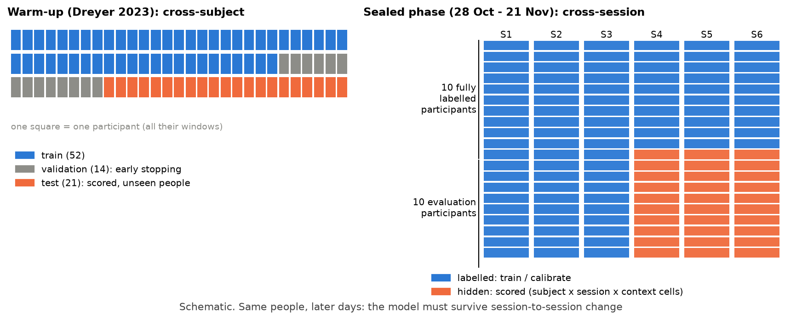
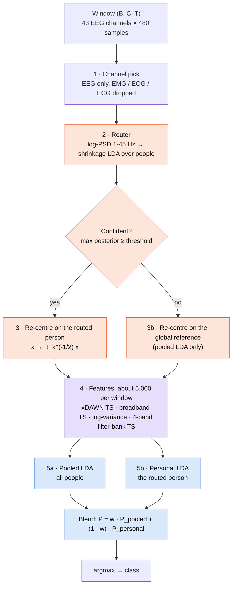
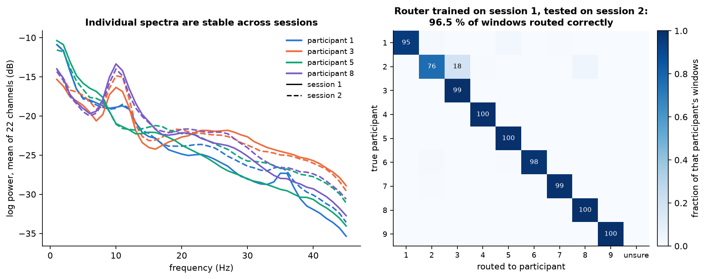
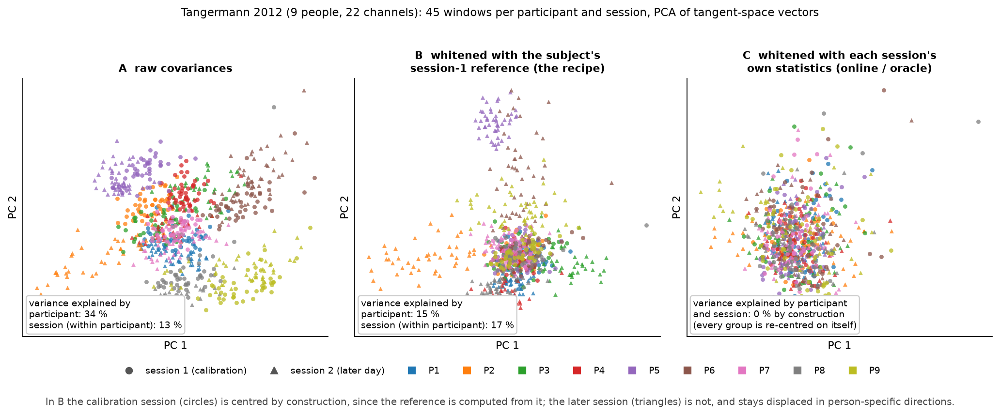
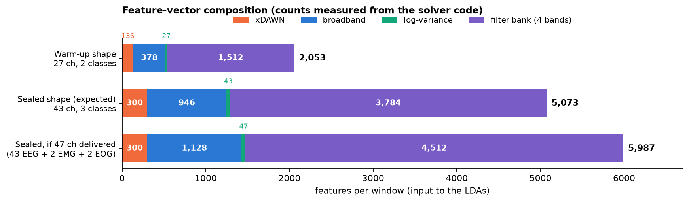
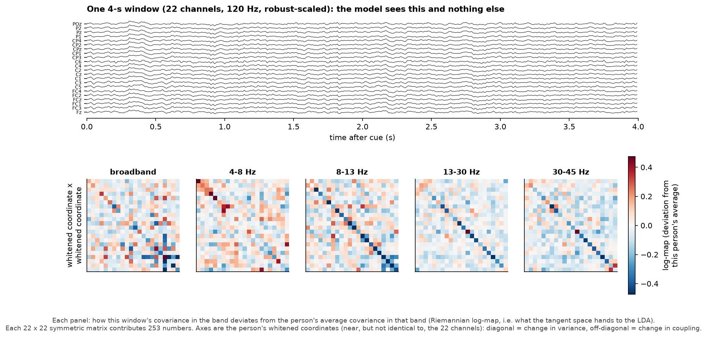
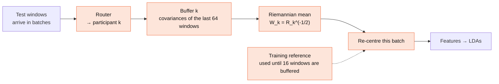
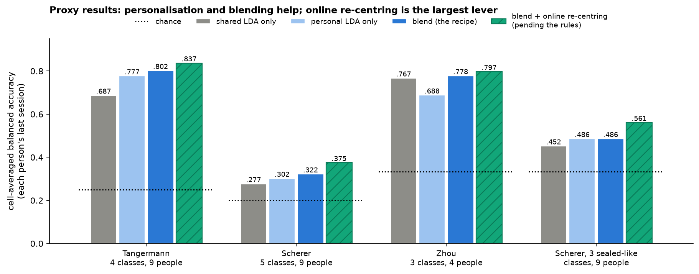
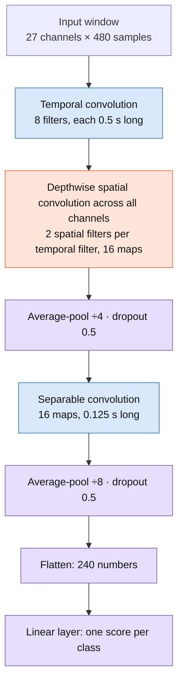
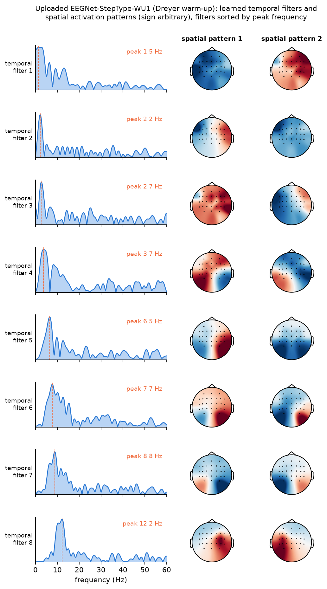

# Model architecture: how our Track 2 models work

_A guide to the two models we built for the EEG/EMG Foundation Challenge 2026,
**Track 2 (BCI decoding)**, written for EEG and BCI researchers. It assumes you
know EEG (rhythms, ERD/ERS, referencing, volume conduction, non-stationarity)
and gives only a short explanation of the machine-learning side: shrinkage LDA,
Riemannian geometry and convolutional networks, each framed in EEG terms._

**Last updated:** 2026-09-29 · **Source of truth for results:**
[SEALED_RECIPE.md](SEALED_RECIPE.md), [SUBMISSIONS.md](SUBMISSIONS.md) and
[LOG.md](LOG.md). Numbers are copied from them. Parameter and feature counts were
measured from the code on 2026-09-29. Figures captioned *real data* were
regenerated that day from the caches and the uploaded weights, the results figure
plots the SEALED_RECIPE tables, and the split figure is a schematic. All are made
by [`analysis/arch_figures.py`](analysis/arch_figures.py).

## Contents

- [1. Summary](#1-summary)
- [2. The task, seen as an EEG problem](#2-the-task-seen-as-an-eeg-problem)
- [3. What the warm-up EEG looks like, and what it implies](#3-what-the-warm-up-eeg-looks-like-and-what-it-implies)
- [4. Riemann-Sealed: the sealed-phase model](#4-riemann-sealed-the-sealed-phase-model)
- [5. EEGNet-StepType: the neural-network model](#5-eegnet-steptype-the-neural-network-model)
- [6. Side by side](#6-side-by-side)
- [7. What gets shipped to Codabench](#7-what-gets-shipped-to-codabench)
- [8. Further reading](#8-further-reading)
- [9. Glossary (machine-learning terms only)](#9-glossary-machine-learning-terms-only)

---

## 1. Summary

Both models classify a 4-s, cue-locked EEG window into a mental command.

| | **Riemann-Sealed** | **EEGNet-StepType** |
|---|---|---|
| Family | A covariance-based (Riemannian) BCI pipeline: xDAWN, broadband and 4-band filter-bank tangent-space features plus log-variance, into shrinkage LDA | A compact temporal-spatial-separable CNN (Lawhern et al., 2018) trained end to end on the raw window |
| Handling of between-subject and between-session differences | A PSD-based **router** infers the participant from the window, **re-centres** the window on that participant's average covariance, and blends a **pooled** and a **personal** LDA | None. One network for everyone |
| Parameters | Closed-form fits: ~5,000-feature LDAs (sealed shape), xDAWN filters, per-person whitening matrices | 1,970 trainable weights (warm-up shape), by gradient descent |
| Role | Our candidate for the **sealed final phase** (cross-session, 3 classes) | The **warm-up upload**, the only one so far (0.82 balanced accuracy, cross-subject, 2 classes) |
| Code | [`riemann_sealed.py`](solvers/bci_decoding/riemann_sealed.py) | [`eegnet_steptype.py`](solvers/bci_decoding/eegnet_steptype.py), frozen warm-up copy [`eegnet_steptype_wu1.py`](solvers/bci_decoding/eegnet_steptype_wu1.py) |

> **Where things stand (2026-09-29).** The sealed-phase training data (private
> Graz + BrainHero cohort) has **not been released**. Riemann-Sealed was designed
> and tested on public stand-in datasets, so every sealed-phase number here is a
> *proxy* result. Its final settings (blend weight, whether to admit EMG/EOG
> channels, per-context re-centring) are fixed on release day by the
> pre-registered rules in [RELEASE_DAY.md](RELEASE_DAY.md). A third model,
> **Riemann-StepType**, is the simpler ancestor of Riemann-Sealed
> ([§4.11](#411-relation-to-riemann-steptype)).

---

## 2. The task, seen as an EEG problem

### 2.1 Paradigm, epoching and what the model receives

| | Warm-up (to 25 Oct) | Sealed final phase (28 Oct to 21 Nov; decides the ranking) |
|---|---|---|
| Data | Public Dreyer 2023 | Private 2026 cohort, two recording contexts: Graz and BrainHero |
| Task | 2-class motor imagery: left vs right hand | 3 cued commands: kinesthetic motor imagery, mental calculation, word association |
| Epoch | 4 s, **starting at the cue** (no pre-cue baseline), 27 channels at 120 Hz | 4-s windows; we expect 43 EEG channels at 120 Hz (NeuralBench's default EEG extractor drops EMG/EOG and resamples). The full specification is 47 channels at 500 Hz: 43 EEG, 2 EMG, 2 EOG. Cue timing, reference and hardware are not yet known to us |
| Generalisation test | Unseen participants (cross-subject) | The same participants on later days (cross-session) |
| Score | Balanced accuracy | Balanced accuracy averaged over subject × session × context cells |

**How the signal reaches the model.** NeuralBench delivers each window after
resampling to 120 Hz and after **per-recording, per-channel robust scaling**
(median and IQR, clamped at ±20). Absolute µV amplitude and across-channel gain
differences are therefore gone before any model runs, so only *relative*
structure survives: which channels covary and how power is distributed across
frequency. There is no baseline period, so baseline-referenced ERD/ERS
percentages cannot be computed; every feature has to be relative within the
window. We add no artefact rejection or ICA, no re-referencing by default
(CAR and a surface Laplacian are options; see [§3](#3-what-the-warm-up-eeg-looks-like-and-what-it-implies)) and no baseline
correction. The `predict` function receives bare `(B, C, T)` windows and no
subject, session or context label.



*Schematic. Left: the warm-up splits by person (Dreyer 2023: 52 / 14 / 21). Right:
the sealed structure as described by the organisers and mirrored by our mock
study: 20 participants × 6 sessions, 10 fully labelled and 10 evaluation
participants whose sessions 1–3 are labelled and 4–6 hidden.*

### 2.2 What the three sealed classes should look like, and what could mislead a model

These are **textbook expectations, not measurements on the sealed data**:

- *Kinesthetic motor imagery:* sensorimotor mu/beta ERD, contralateral when the
  imagined limb is lateralised.
- *Mental calculation:* frontal-midline theta increase and parietal alpha
  desynchronisation, and possibly more ocular activity.
- *Word association:* left-lateralised frontotemporal activity, with possible
  subvocal or facial muscle activity.

The last two are exactly the classes where non-neural signals could separate the
classes on the training days and then drift, so **artefact shortcuts are a
design concern** ([§4.2](#42-front-end-and-channel-selection)).

### 2.3 Four constraints that shape the design

1. **Inter-subject variability.** The mixing of sources into sensors (head
   geometry, cap placement, impedance) differs between people, as do individual
   spectra (the individual alpha peak, spectral slope, noise floor).
2. **Between-session non-stationarity.** Re-applying the cap, impedance drift,
   vigilance and imagery strategy all change the sensor-space signal from one day
   to the next. The sealed phase tests exactly this.
3. **Few labelled windows per person.** That favours compact features and
   regularised linear classifiers over high-capacity models.
4. **No identifiers at prediction time.** A person-specific method has to infer
   the person from the window itself.

| Constraint | What handles it in Riemann-Sealed |
|---|---|
| Inter-subject variability | Per-person re-centring (§4.4) and a personal LDA (§4.6) |
| No identifiers at prediction time | The router (§4.3) |
| Between-session non-stationarity | Only partly: the blend weight is chosen on a held-out *session* (§4.6). The largest remaining gap; the online option (§4.7) addresses it but is pending the rules |
| Few labelled windows per person | Compact regularised features, shrinkage LDA, and a pooled LDA across people |
| Balanced accuracy | Equal class priors in the pooled and personal LDAs |
| Non-neural shortcuts | EEG channels only by default (§4.2) |

---

## 3. What the warm-up EEG looks like, and what it implies

Before designing anything we ran an EDA on the exact windows a solver receives
([reports/dreyer_eda/README.md](reports/dreyer_eda/README.md); 87 participants,
20,792 windows). The findings that drove the architecture:

| Signal | Where and when | Strength |
|---|---|---|
| **Slow lateralised potential** (< 4 Hz waveform) | Right-hand imagery is left-negative and right-positive, peak FC5/C5/C3, from ~0.5 s to 4 s | Strongest. Peak d = −0.33, same sign in 79 % of people, 0.77 cross-subject with a plain LDA on the waveform |
| **Mu ERD** (10–13 Hz) | Less mu over the contralateral C3 (right-hand imagery), more over C4 | C3 d = −0.10, C4 d = +0.12; 0.64 cross-subject |
| Beta (13–30 Hz) | Weaker, mostly right hemisphere | 0.61 cross-subject |
| Delta/theta *power* | none | Near chance (0.52–0.59): the slow information is waveform, not power |
| Cue responses | Two large responses at ~0.4 s and ~1.6 s (likely the arrow appearing and disappearing) | Identical for both classes; carry no class information |


*Dreyer EDA, figure 05: the < 4 Hz waveforms and the left-negative,
right-positive gradient that grows over the epoch.*


*Dreyer EDA, figure 06: the classic contralateral mu ERD/ERS pattern, narrow
around 10–13 Hz and present from ~0.6 s to the end of the epoch.*

**Other observations** from the same EDA: the individual alpha peak has a median
of 10.5 Hz (10–90 % range 9.0–12.2 Hz); 30–45 Hz power varies by about ±8 dB
between people and runs hotter over lateral channels (jaw and temporal muscle);
and the eye-movement check (slow-waveform decoding by channel group) points to a
fronto-central cortical potential more than an ocular artefact, but with the EOG
channels stripped and F7/F8 not recorded, a partial ocular contribution cannot
be excluded.

**Consequences for the architecture:**

- **An 8–30 Hz band-pass hurts on the warm-up.** EEGNet collapsed to chance
  (0.500) and the Riemann model kept only 0.60 in the pilot, because most of the
  left/right information sits below 8 Hz. Neither model band-limits its input by
  default.
- **The Riemann filter bank has no band below 4 Hz.** The broadband covariance
  and xDAWN are not band-limited and can still see slow activity. An explicit
  0.1–4 Hz binned-waveform block (`slow_block`) added only +0.003 on the warm-up
  and is off in Riemann-Sealed.
- **xDAWN is meaningful here because the windows are cue-locked.** A class-mean
  time-locked template exists. Switching xDAWN off drops the Dreyer score from
  0.754 to 0.592 (Riemann-StepType, no filter bank) but changes nothing
  measurable on the three sealed-like classes of the Scherer proxy (+0.2 points,
  95 % CI −2.4 to +3.1). This fits the interpretation that on Dreyer xDAWN is
  mainly capturing the time-locked slow potential. That is our reading, not a
  separate test.
- **CAR helped a 2,560-window pilot (+0.02 to +0.04) but not full training**
  (EEGNet 0.803 with CAR vs 0.806 without; Riemann 0.746 vs 0.754), so the
  default is no re-reference. The Laplacian lagged CAR, possibly because
  per-channel robust scaling distorts the spatial physics it assumes.
- **A fixed 8–13 Hz band covers most people, but the individual alpha peak spans
  about 3 Hz.** Subject-specific bands are not implemented.

---

## 4. Riemann-Sealed: the sealed-phase model

### 4.1 Overview



*Orange: adapting to the person. Purple: features. Blue: classifiers.* In the
fallback path (an unsure router) the personal LDA is skipped and the pooled LDA's
output is used as is.

Every step is a direct calculation on the window; nothing is learned by gradient
descent, so training is deterministic.

### 4.2 Front end and channel selection

- **Preprocessing:** none by default (`bandpass="none"`, `reference="none"`). The
  optional band-pass is a zero-phase FFT mask with cosine skirts on each
  reflect-padded window, not a streaming IIR or FIR filter.
- **Channel selection** (`chans="eeg"`): EMG, EOG and ECG channels are dropped,
  typed from the dataset's channel metadata and falling back to the channel
  name. The model stores the training channel names and matches the scoring
  channels by name at load time (it reorders if needed and refuses to run if a
  trained channel is missing), so a shuffled channel order cannot pass silently.
- **Why EEG only.** An "easy" class separated by muscle or eye activity on the
  training days can drift away on later days. Whether adding EOG or EMG helps *and*
  survives later sessions is decided by an ablation on release day.
- **A leak the channel pick does not close.** Scalp EEG still carries EMG in the
  30–45 Hz band, and the filter bank includes it. The bands are hard-coded, so
  there is currently no switch to drop that band.

### 4.3 Step 2: the router (identifying the participant from the window)

Because `predict` gets no identifier, the model infers the participant.

- **Features:** the log power spectrum of every channel (Welch, 1-s segments, so
  1-Hz bins from 1 to 45 Hz): 43 × 45 = 1,935 numbers at 120 Hz.
- **Classifier:** a shrinkage LDA trained to predict *which participant* a window
  belongs to. What makes the spectrum identifying is a mix of physiology (the
  individual alpha peak, spectral slope) and recording set-up (cap and impedance,
  muscle noise floor). The router does not care which, only that the fingerprint
  is stable across days.
- **Confidence gate:** if the top posterior is below a threshold, the window
  falls back to the global reference and the pooled LDA. The threshold is the 1st
  percentile of the router's out-of-fold confidence on training windows, capped
  at 0.5. The cap matters: with one calibration session the uncapped threshold
  reached 1.0 and about half of one dataset's later windows fell back.



*Real data (Tangermann 2012, 9 people). Left: mean log power over the 22
channels for four participants, session 1 solid and session 2 dashed. Right: a
router trained on session 1 and applied to session 2 routes 96.5 % of windows
correctly, reproducing the 0.965 in [SEALED_RECIPE.md § 2](SEALED_RECIPE.md#2-evidence).*

On the stand-in datasets it named the right person for 87–100 % of windows from
later sessions. **The open risk** is a change of set-up between days or contexts
(Graz vs BrainHero) that moves the fingerprint; the per-(subject, context)
variant of §4.7 exists for that case.

### 4.4 Step 3: per-person re-centring

**The idea in EEG terms.** Model the sensor signal as x = A s, where s are the
sources and A is a person- and session-specific mixing (head geometry, cap
position, impedance). The sensor covariance is then C_x = A C_s Aᵀ. For each
training participant the model computes the mean covariance R of their windows
(the Riemannian mean by default; the Euclidean mean is He and Wu's Euclidean
Alignment) and multiplies every window of that person by R^(-1/2). After this,
the person's average covariance is the identity, which removes A **up to an
unknown orthogonal rotation**: the eigenvalues survive, the mixing does not. The
same operation on the covariances is the Riemannian re-centring of Zanini et al.

At prediction time each window is re-centred with the *routed* person's matrix.



*Real data (Tangermann 2012): PCA of tangent-space vectors, 45 windows per
participant and session. A: raw covariances cluster by participant (34 % of the
variance) with a session offset. B: with the reference from the calibration
session (the recipe), that session is centred by construction, but the later
session stays displaced in person-specific directions (session offset 17 % of the
remaining variance). C: re-centring each session on its own statistics merges
everything (0 % by construction, so the panel shows the ceiling, not a finding).*

**What it buys, honestly.**

- Re-centring on the training-time reference removes the *person* difference for
  the calibration data but **not the later-session drift** (panel B). That is why
  the clean recipe gains little from it for per-person classifiers, and why only
  statistics from the test session fix drift (the online option, §4.7).
- On the stand-in datasets it raised a *pooled* classifier by up to about 5 points
  (+4.8 on Tangermann, +1.8 on Scherer, level on Zhou) and left per-person
  classifiers about unchanged. The likely reason is affine invariance: a tangent
  space centred on a person's own mean is nearly blind to re-centring on that same
  mean.
- **Residual rotation.** Because the mixing is only removed up to a rotation,
  alignment is not perfect. Riemannian Procrustes analysis (Rodrigues et al., 2019)
  adds stretching and rotation steps on top of re-centring; we do not.

### 4.5 Step 4: features (about 5,000 numbers per window)

**Covariance and the tangent space, for EEG readers.** Log-variance per channel is
the simplest band-power feature, and CSP maximises a variance ratio along
learned spatial filters. A covariance matrix keeps the whole spatial structure,
including the between-channel terms, without committing to specific filters.
Covariance matrices are symmetric positive definite (SPD) and live on a curved
manifold, so Euclidean distance between them is misleading. The **tangent space**
is the standard remedy: linearise the manifold at a reference point (a mean
covariance) with the matrix logarithm log(R^(-1/2) C R^(-1/2)); the upper triangle
of the result is an ordinary vector of C(C+1)/2 numbers on which linear
classifiers work well (Barachant et al., 2012).

| Block | Content | Numbers, 43 ch × 3 classes | Numbers, 27 ch × 2 classes |
|---|---|---|---|
| **xDAWN** | Supervised spatial filters (4 per class) that enhance the class-mean time-locked response (Rivet et al., 2009); the covariance of the filtered signals, with the class templates appended, into a tangent space | 300 | 136 |
| **Broadband** | OAS-shrunk covariance of the whole window into a tangent space | 946 | 378 |
| **Log-variance** | Broadband log power per channel | 43 | 27 |
| **Filter bank** | The broadband step after band-passing to 4–8, 8–13, 13–30 and 30–45 Hz, one tangent space per band (a Riemannian counterpart of FBCSP; Ang et al., 2008) | 3,784 (4 × 946) | 1,512 (4 × 378) |
| **Total** | | **5,073** | **2,053** |



*The 27- and 43-channel counts were measured by fitting the solver's own code. The
47-channel row applies the same formula and matches the 5,987 documented in the
solver.*



*Real data (Tangermann 2012). What the tangent space hands to the classifier for
one window: the deviation of its band covariance from the person's average
(Riemannian log-map). The axes are the person's whitened coordinates, which are
near, but not identical to, the 22 channels.*

**Design notes.**

- **Bands** are fixed, not subject-specific, and there is nothing below 4 Hz or
  above 45 Hz (§3).
- **OAS** (Chen et al., 2010) shrinks each covariance toward a scaled identity,
  which steadies a 43-channel estimate from 480 samples.
- The band-pass and covariance are computed per window, so no block uses
  information from other windows except the tangent-space reference points and
  the xDAWN filters, both fitted on the (re-centred) training windows.

### 4.6 Step 5: classifiers and the blend

**Shrinkage LDA.** Linear discriminant analysis models each class as a Gaussian
with a shared covariance and yields linear decision boundaries and class
probabilities. With ~5,000 features and far fewer windows the pooled covariance is
badly conditioned, so its estimate is regularised with (Ledoit–Wolf) shrinkage, the
standard choice in ERP and BCI decoding (Blankertz et al., 2011). Priors are equal,
matching balanced accuracy.

Two kinds of LDA sit on the **same** features:

- **Pooled LDA:** trained on the re-centred windows of all participants.
- **Personal LDA:** one per participant, trained on that person's windows only.

The final probabilities are a blend, called `blend_calib`:

```text
P(class) = w × P_pooled(class) + (1 − w) × P_personal(class)
```

**Choosing w without touching the test data.** `w` comes from
{0, 0.25, 0.5, 0.75, 1} by leave-one-calibration-session-out. With sessions 1–3
as calibration data:

| Fold | Refit on | Score on |
|---|---|---|
| 1 | sessions 2, 3 | session 1 |
| 2 | sessions 1, 3 | session 2 |
| 3 | sessions 1, 2 | session 3 |

Each fold refits xDAWN, the tangent spaces and all LDAs, scores each `w` with
cell-averaged balanced accuracy (using each window's true participant's personal
LDA), and the `w` with the best mean over folds wins, with ties going to the more
pooled value. On the stand-ins it landed on 0, 0.5 or 0.75.

*A worked example with illustrative numbers, three classes, w = 0.5:*

| | Class 1 | Class 2 | Class 3 |
|---|---|---|---|
| Pooled LDA | 0.55 | 0.30 | 0.15 |
| Personal LDA | 0.20 | 0.65 | 0.15 |
| **Blend** | 0.375 | **0.475** | 0.15 |

Why blend: with plenty of clean data the personal LDA wins; with scarce or
drifting data the pooled one is safer. On the stand-ins the blend was never
significantly worse than either.

### 4.7 Optional add-ons (off by default)

**Online re-centring** (`adapt="online"`) replaces the training-time reference
with a running estimate from the test stream:



It tracks session drift as it happens and was the **largest single gain
measured**: +3.5 to +7.5 points when test windows arrive in recording order, and
+3.0 to +4.4 when participants are interleaved window by window. **It stays off**
because it uses statistics of unlabelled test windows (test-time adaptation), which
the rules neither allow nor forbid. The question for the organisers is drafted in
[SEALED_RECIPE.md § 5](SEALED_RECIPE.md#5-next-steps-ranked).

**Per-context re-centring** (`align="subject_context"`) routes and re-centres per
(participant, context) pair instead of per participant, for the case where Graz and
BrainHero recordings differ enough to shift the covariance. A pair with fewer than
16 training windows keeps its participant's reference. It cannot be combined with
online re-centring, and whether it helps is decided on release day.

### 4.8 How it is trained

Training happens offline on the labelled early sessions; Codabench runs only
`predict`.


On a full-size mock of the sealed data (120 Hz, CPU only) one complete run of the
training script, including its checks and a read-only replay of the saved model,
took 41 minutes with a fixed blend weight and 61 minutes with `w` chosen
automatically.

### 4.9 Evidence

All numbers are cell-averaged balanced accuracy on each person's **last** session,
on three public stand-in datasets (four test setups, because Scherer is scored
with 5 classes and again with the 3 sealed-like ones), with only 4 to 9 people
each. Differences under about 2 points are noise. Full tables and bootstrap
confidence intervals: [SEALED_RECIPE.md § 2](SEALED_RECIPE.md#2-evidence).



The personal classifier beats the pooled one where each person has one
calibration session (Tangermann, Scherer), and the reverse holds on Zhou (four
people, two sessions each). The blend matches or beats the better of the two in
every setup. Online re-centring adds a significant gain on three of the four setups
(not on Zhou: +1.8, 95 % CI −3.0 to +4.8).

On the one sealed-like *cognitive* proxy we have (Zyma 2019, mental arithmetic vs
rest, cross-subject), the filter bank alone reached 0.734 and all blocks 0.723,
against 0.512 for the organisers' MeanLogReg floor; per-person re-centring lifts
that to 0.76–0.78.

### 4.10 Open questions (need the released data)

- **EMG and EOG channels:** help, hurt, or a drifting shortcut. On the synthetic
  mock, a decaying EMG confound costs 3.7 to 4.2 points on the release-day split
  and is invisible (+0.8) on the wrong one, which is why the replica split matters.
- **500 Hz and 43 channels:** the loader may deliver 120 Hz; memory and time sizing
  at 500 Hz already pass on the mock (fit 30 min, 12 GB).
- **Contexts:** whether Graz and BrainHero need their own re-centring.
- **Test-window order and batching:** the online gain depends on it.
- **Known bias in the weight search:** each held-out session is re-centred with a
  reference that includes its own windows (~2 points of CV bias); it has never
  changed a chosen weight, and [RELEASE_DAY.md](RELEASE_DAY.md) rule 4 carries an
  interim guard.
- **Scoring image:** no scikit-learn/pyriemann joblib has ever run on it; a warm-up
  deployment test is recommended in [SUBMISSIONS.md](SUBMISSIONS.md).

The full list, with the planned experiment for each, is in
[SEALED_RECIPE.md § 3](SEALED_RECIPE.md#3-untested-until-the-graz--brainhero-data-arrives).

### 4.11 Relation to Riemann-StepType

**Riemann-StepType** ([`riemann_steptype.py`](solvers/bci_decoding/riemann_steptype.py))
is the Track 2 port of the thesis Riemannian model: xDAWN, broadband and
log-variance features into one LDA, with the filter bank optional. Riemann-Sealed is
that plus the filter bank switched on, the router, per-person re-centring and the
personal-LDA blend. A submission must be one file, so `riemann_sealed.py` carries
its own copy of the shared code. The thesis version and its results are in
[`../MODELS.md` § 5.5](../MODELS.md#55-riemannian--covariance-comparator).

---

## 5. EEGNet-StepType: the neural-network model

### 5.1 Relation to the classic pipeline

EEGNet (Lawhern et al., 2018) is a deliberately small CNN whose three stages
mirror a classic filter-bank spatial-filtering pipeline, with every stage learned:

| Classic pipeline | EEGNet stage |
|---|---|
| Band-pass filter bank | **Temporal convolution:** 8 learned FIR filters, 0.5 s long |
| Spatial filters (CSP-like), per band | **Depthwise spatial convolution:** 2 learned spatial filters per temporal filter |
| Log-variance or band-power summary | **Pooling and a separable convolution:** a learned summary of the filtered time course |
| LDA or SVM | **A linear layer** with softmax |

Our version is a faithful PyTorch port of the thesis's Keras EEGNet, with changes
for this track: a multi-class output instead of a single yes/no score, no branch
for hand-crafted features (the competition supplies only raw windows), kernel
lengths given in seconds so they adapt to the sampling rate, and validation on
held-out participants.

### 5.2 Layer by layer



*Blue: temporal filtering. Orange: spatial filtering. Purple: summary and output.*
Shapes are for the warm-up input (27 channels, 480 samples, 2 classes) at 120 Hz;
the kernels are 60 and 15 samples there.

| Stage | Output (maps × channels × time) | Weights |
|---|---|---|
| Input | 1 × 27 × 480 | 0 |
| Temporal convolution + batch norm | 8 × 27 × 480 | 496 |
| Spatial (depthwise) convolution + batch norm, ELU, pool ÷4, dropout | 16 × 1 × 120 | 464 |
| Separable convolution + batch norm, ELU, pool ÷8, dropout | 16 × 1 × 15 | 528 |
| Classifier (flatten 240 → one score per class) | 2 | 482 |
| **Total** | | **1,970** |

At the sealed shape (43 channels, 3 classes) the total is 2,467.

### 5.3 What the uploaded network learned

We plotted the learned filters of the uploaded EEGNet-StepType-WU1. The spatial
maps are **activation patterns**, obtained from the learned spatial filters and the
covariance of the temporally filtered training windows (the Haufe et al., 2014
transform), because raw filter weights are not interpretable as topographies.



*Real weights and 1,500 randomly chosen Dreyer training windows. Left: magnitude
response of each temporal filter (the 0.5-s kernel limits the resolution to about
2 Hz). Right: the two spatial activation patterns of that filter, scaled to unit
maximum, with arbitrary sign.*

What the figure shows:

- **Four of the eight temporal filters peak below 4 Hz** (1.5, 2.2, 2.7 and
  3.7 Hz), one at 6.5 Hz (theta), two at 7.7 and 8.8 Hz (upper theta to alpha) and
  one at 12.2 Hz (mu). The network devoted half its temporal filters to the slow
  band that the Riemann filter bank does not cover (§3).
- Several of the slow filters (1 to 3) have patterns with a broad left-right
  frontal-central gradient, on the same left-right axis as the lateralised slow
  potential of EDA figure 05. The fourth slow filter's patterns look different.
- The 12.2-Hz filter's two patterns are centred over right and left central
  sites respectively, the layout of the contralateral mu ERD in EDA figure 06.

These are qualitative matches to the EDA, not a test, and the weights say nothing
about which filters the classifier relies on most. They do support the
hypothesis (ours, untested) that part of EEGNet's warm-up advantage over the
Riemann pipeline (0.82 vs 0.77) comes from slow activity.

### 5.4 How it is trained

- **Loss and optimiser:** cross-entropy, Adam, learning rate 0.001.
- **Regularisation:** dropout 0.5 in two places, and max-norm constraints on the
  spatial and final layers, re-applied after every step (inherited from the Keras
  version).
- **Early stopping:** every 5th *participant* is held out for validation, training
  stops when the validation loss has not improved for `patience` epochs, and the
  best weights are restored. Holding out whole people means validation measures
  generalisation to new people, which is what the warm-up scores.
- **The uploaded configuration, WU1:** up to 100 epochs, patience 20, no
  re-referencing, seed 33 (frozen in
  [`eegnet_steptype_wu1.py`](solvers/bci_decoding/eegnet_steptype_wu1.py)). On the
  full warm-up training set (12,392 windows) an epoch takes about 13 s on this CPU,
  so 100 epochs is at most about 20 minutes.

### 5.5 Results and limits

| Warm-up (Dreyer, 2 classes, chance 0.50) | Balanced accuracy |
|---|---|
| **EEGNet-StepType-WU1**, local score | **0.820** (mean over 3 seeds 0.806 ± 0.016) |
| Codabench public leaderboard for our upload (presumed to be WU1; [SUBMISSIONS.md](SUBMISSIONS.md) still says "confirm") | 0.82 |
| Upstream braindecode EEGNet | 0.778 ± 0.013 |
| Riemann-StepType with filter bank | 0.770 |
| MeanLogReg (organisers' floor) | 0.681 |

On the warm-up, with thousands of windows from many people, a small network wins.
The picture reverses on the sealed-style stand-ins: EEGNet-StepType is 6–12 points
below the Riemann pipeline in every comparison made there. The clearest sign is
the no-re-centring stand-in table in [SEALED_RECIPE.md § 2](SEALED_RECIPE.md#2-evidence):
trained *per person*, EEGNet-StepType scores 0.546 on Tangermann against 0.775 for
the Riemann pipeline, while trained on everyone pooled the two are level (0.644 vs
0.639). Our reading, not separately tested: even ~2,000 weights need more data than
one person's calibration sessions provide, and a network has no built-in way to
re-centre on a person the way §4.4 does. That is why EEGNet is not in the sealed
recipe.

---

## 6. Side by side

| | Riemann-Sealed | EEGNet-StepType |
|---|---|---|
| Features | Designed (covariance, tangent space, log-variance, xDAWN) | Learned (temporal and spatial filters) |
| Sees slow (< 4 Hz) activity? | Through the broadband covariance and xDAWN only; the filter bank starts at 4 Hz | Yes: 4 of 8 learned temporal filters peak below 4 Hz |
| Classifier | Linear (shrinkage LDA), pooled and per person | The network's final linear layer, one for everyone |
| Adapts to the individual | Router, re-centring and personal LDA | No |
| Cross-session drift | Only partly; online re-centring pending the rules | No handling |
| Training | Closed-form fits, no epochs | Gradient descent, up to 100 epochs |
| Best evidence | Sealed-style stand-ins (§4.9) | Warm-up: 0.82 |
| Weak spot | Untested on the real sealed data | Poor when trained per person |

A probability-level ensemble of both is ranked as a possible next step (about +1–2
points expected) in [SEALED_RECIPE.md § 5](SEALED_RECIPE.md#5-next-steps-ranked).

---

## 7. What gets shipped to Codabench

A submission is a ZIP holding `submission.py` (all the Python) plus the trained
numbers. Codabench loads it and runs **inference only**, under an hour for the full
test set. See [SUBMISSION_GUIDE.md](SUBMISSION_GUIDE.md) for the contract.

- **Riemann-Sealed** ships `riemann_sealed.joblib`: NumPy arrays (re-centring
  matrices, the channel list) and fitted scikit-learn and pyriemann objects (the
  router, xDAWN, tangent spaces, the LDAs and the blend weight). Only library
  objects are pickled, never classes defined in our file, so they unpickle on the
  scoring machine; the pipeline itself is rebuilt in code at load time. On the mock,
  3,600 windows at 500 Hz replayed in 77 s.
- **EEGNet-StepType** ships `weights.pt`.
- Codabench runs the **default parameters** written in the solver file, so the
  release-day scripts write the chosen settings into the file's defaults before
  zipping.
- The scoring machine may hand over data on a GPU; Riemann-Sealed moves windows to
  the CPU first because its maths runs in NumPy.

---

## 8. Further reading

- Barachant A, Bonnet S, Congedo M, Jutten C (2012). Multiclass brain–computer
  interface classification by Riemannian geometry. *IEEE Trans Biomed Eng* 59(4).
- Congedo M, Barachant A, Bhatia R (2017). Riemannian geometry for EEG-based
  brain–computer interfaces: a primer and a review. *Brain-Computer Interfaces* 4(3).
- Rivet B, Souloumiac A, Attina V, Gibert G (2009). xDAWN algorithm to enhance
  evoked potentials: application to brain–computer interface. *IEEE Trans Biomed Eng* 56(8).
- Ang KK, Chin ZY, Zhang H, Guan C (2008). Filter bank common spatial pattern
  (FBCSP) in brain-computer interface. *IJCNN*.
- He H, Wu D (2020). Transfer learning for brain–computer interfaces: a Euclidean
  space data alignment approach. *IEEE Trans Biomed Eng* 67(2).
- Zanini P, Congedo M, Jutten C, Said S, Berthoumieu Y (2018). Transfer learning: a
  Riemannian geometry framework with applications to brain–computer interfaces.
  *IEEE Trans Biomed Eng* 65(5).
- Rodrigues PLC, Jutten C, Congedo M (2019). Riemannian Procrustes analysis:
  transfer learning for brain–computer interfaces. *IEEE Trans Biomed Eng* 66(8).
- Blankertz B, Lemm S, Treder M, Haufe S, Müller K-R (2011). Single-trial analysis
  and classification of ERP components: a tutorial. *NeuroImage* 56(2).
- Chen Y, Wiesel A, Eldar YC, Hero AO (2010). Shrinkage algorithms for MMSE
  covariance estimation. *IEEE Trans Signal Process* 58(10).
- Lawhern VJ et al. (2018). EEGNet: a compact convolutional neural network for
  EEG-based brain–computer interfaces. *J Neural Eng* 15(5).
- Haufe S et al. (2014). On the interpretation of weight vectors of linear models in
  multivariate neuroimaging. *NeuroImage* 87.

*These references were written from memory, not looked up; check the details
before citing them formally.*

**In this repository:**

| If you want | Read |
|---|---|
| The evidence behind each design choice, with all tables | [SEALED_RECIPE.md](SEALED_RECIPE.md) |
| The warm-up EEG in full | [reports/dreyer_eda/README.md](reports/dreyer_eda/README.md) |
| The task, datasets and commands | [TRACK2_BCI.md](TRACK2_BCI.md) |
| What to do when the sealed data is released | [RELEASE_DAY.md](RELEASE_DAY.md) |
| How to build, test and zip a submission | [SUBMISSION_GUIDE.md](SUBMISSION_GUIDE.md) |
| How the thesis models were adapted for this track | [REUSING_MY_MODELS.md](REUSING_MY_MODELS.md) |
| The thesis versions of these models | [`../MODELS.md`](../MODELS.md) (§ 5.5 Riemannian, § 5.7b EEGNet PyTorch port) |
| The code | [`solvers/bci_decoding/`](solvers/bci_decoding/): `riemann_sealed.py` has a long docstring that is a precise spec of every option |
| How the figures here were made | [`analysis/arch_figures.py`](analysis/arch_figures.py) → [`figures/`](figures/) |

---

## 9. Glossary (machine-learning terms only)

- **LDA (linear discriminant analysis):** a classifier that models each class as a
  Gaussian with a shared covariance and separates classes with a linear boundary; it
  outputs class probabilities. **Shrinkage:** pulling its covariance estimate toward
  a simpler one so it stays stable when features are many and samples few.
- **Posterior / probability:** the classifier's estimated chance that a window
  belongs to each class.
- **SPD matrix and manifold:** covariance matrices are symmetric positive definite,
  and the set of such matrices is a curved space, not a flat vector space.
- **Riemannian mean:** the average of SPD matrices under that curved geometry.
- **Tangent space and log-map:** the flat space touching the manifold at a
  reference point, and the map that projects a matrix into it, turning it into an
  ordinary vector.
- **Whitening / re-centring:** multiplying data by R^(-1/2) so that a reference
  covariance R becomes the identity.
- **OAS:** a shrinkage covariance estimator (Oracle Approximating Shrinkage).
- **Pooled vs personal model:** one model trained on everyone, versus one model per
  person.
- **Leave-one-session-out:** validation that holds out a whole recording session,
  training on the others.
- **Convolution:** sliding a small learned filter along the input. **Depthwise:**
  one filter per input map. **Separable:** a depthwise filter followed by a 1 × 1
  mix across maps.
- **Batch norm:** rescales a layer's outputs to a steady range during training.
  **ELU:** a smooth activation function. **Pooling:** averaging neighbouring values
  to shrink the data. **Dropout:** randomly switching off units while training to
  reduce overfitting. **Max-norm:** capping the size of a weight vector.
- **Early stopping:** ending training when validation loss stops improving.
- **Proxy / stand-in dataset:** a public dataset used to test ideas while the real
  sealed-phase training data is unavailable.
