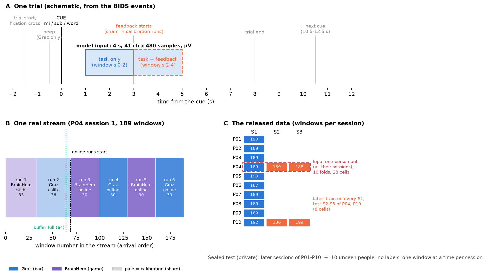
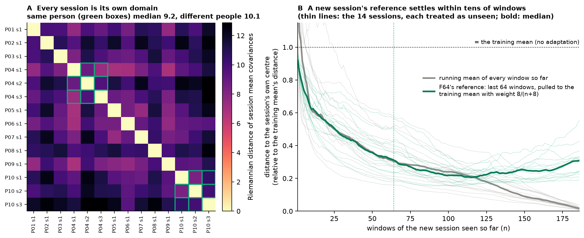
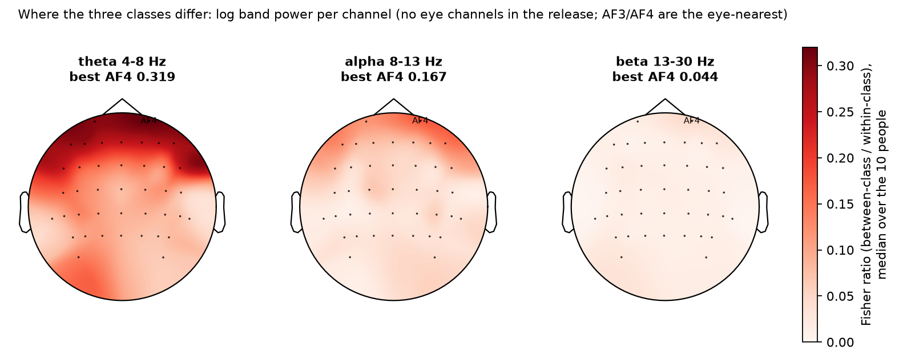
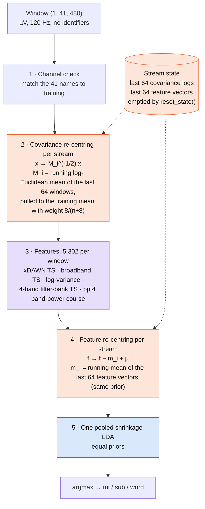
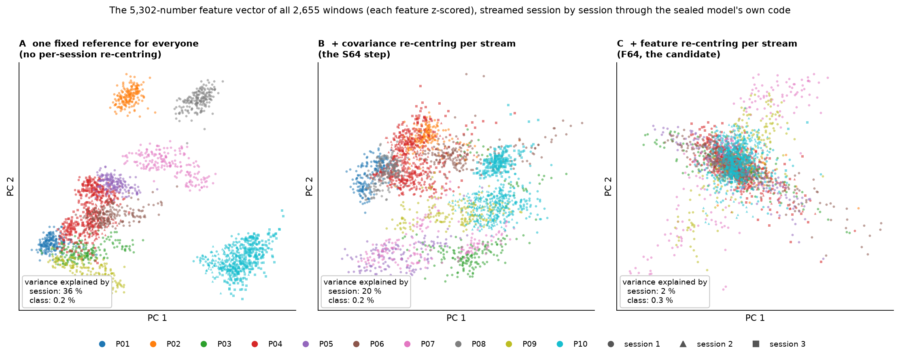
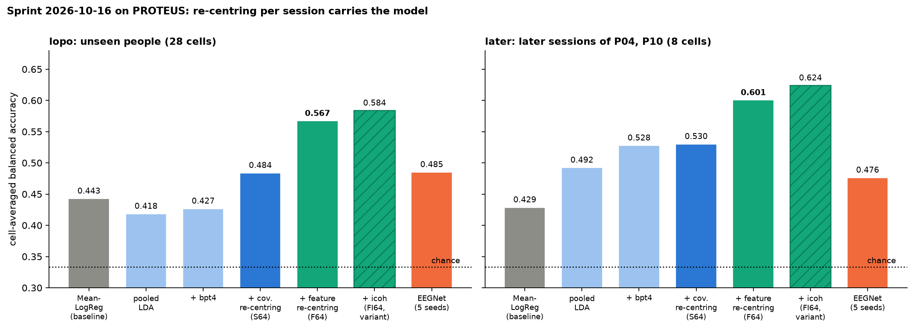
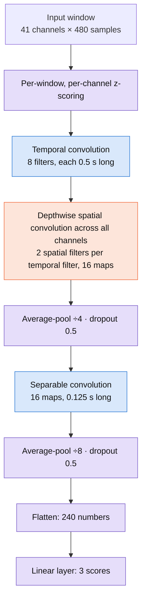

# Model architecture: how our Track 2 models work

_A guide to the models we built for the EEG/EMG Foundation Challenge 2026,
**Track 2 (BCI decoding)**, written for EEG and BCI researchers. It assumes you
know EEG (rhythms, ERD/ERS, referencing, volume conduction, non-stationarity)
and explains only the machine-learning side: shrinkage LDA, Riemannian geometry,
streamed re-centring and convolutional networks, each framed in EEG terms._

**Last updated:** 2026-10-26, rewritten for the released PROTEUS data and the
sealed-phase candidate **F64**. **Source of truth for results:**
[LOG.md](LOG.md) "2026-10-16 sprint", `logs/proteus_w1016/RESULTS_p*.md`,
[SUBMISSIONS.md](SUBMISSIONS.md) and [PROTEUS_SETUP.md](PROTEUS_SETUP.md). Numbers
are copied from them. Feature counts were measured from the sealed zips on
2026-10-26. Figures are made by [`analysis/arch_figures.py`](analysis/arch_figures.py)
from the PROTEUS window cache and the sealed model itself; figures labelled
*schematic* or *warm-up data* say so. The previous version of this document
(2026-09-29, written before the data were released, around a router and
personal classifiers) is in git at commit `bfbeea6`.

## Contents

- [1. Summary](#1-summary)
- [2. The task, seen as an EEG problem](#2-the-task-seen-as-an-eeg-problem)
- [3. What the PROTEUS EEG looks like, and what it implies](#3-what-the-proteus-eeg-looks-like-and-what-it-implies)
- [4. F64: the sealed-phase model](#4-f64-the-sealed-phase-model)
- [5. EEGNet: the neural-network model](#5-eegnet-the-neural-network-model)
- [6. Side by side](#6-side-by-side)
- [7. What gets shipped to Codabench](#7-what-gets-shipped-to-codabench)
- [8. Further reading](#8-further-reading)
- [9. Glossary (machine-learning terms only)](#9-glossary-machine-learning-terms-only)

---

## 1. Summary

Every model classifies a 4-s EEG window into one of three cued mental tasks:
kinesthetic motor imagery (`mi`), mental subtraction (`sub`) or word
association (`word`). Chance is 0.333.

| | **F64** (Riemann-Sealed, `proteus_f64` settings) | **EEGNet-Stream** |
|---|---|---|
| Family | Covariance-based (Riemannian) BCI pipeline: xDAWN, broadband and 4-band filter-bank tangent space, log-variance and a band-power time course, into one shrinkage LDA | A compact convolutional network (Lawhern et al., 2018), trained end to end on the window |
| Handling of between-session and between-person differences | **Two running re-centrings per session**, computed from that session's own unlabelled windows as they arrive: first the covariance, then the feature vector | Per-window, per-channel z-scoring inside the network |
| Learned numbers | Closed-form fits: xDAWN filters, five tangent-space reference points, an LDA on 5,302 features | 2,435 weights, by gradient descent (80 epochs) |
| Unseen people (`lopo`, 28 cells) | **0.567** | 0.485 (5 seeds) |
| Later sessions (`later`, 8 cells) | **0.600** | 0.476 |
| Role | **The sealed-phase candidate**; zip ready | Tested, not used (no gain alone or in an ensemble) |
| Code | [`riemann_sealed_proteus_f64.py`](solvers/bci_decoding/riemann_sealed_proteus_f64.py) (the settings baked into [`riemann_sealed.py`](solvers/bci_decoding/riemann_sealed.py)) | [`eegnet_stream.py`](solvers/bci_decoding/eegnet_stream.py) |

> **Where things stand (2026-10-26).** F64 was chosen on 2026-10-16 by
> pre-registered rules, and a nested check found no over-selection (§ 4.8). Two
> zips are ready: one trained on all 14 sessions for the sealed phase, and one
> trained on the organisers' split for the warm-up. The warm-up copy was
> uploaded on 2026-10-26 as a format and runtime check; its result was pending
> when this was written. The sealed phase (Oct 28 – Nov 21, 10 uploads) is the
> only one that ranks. A variant, **FI64** (F64 plus imaginary coherence), is
> ready as a later upload (§ 4.8).

---

## 2. The task, seen as an EEG problem

### 2.1 Paradigm, epoching and what the model receives

The data are **PROTEUS** (BCI Bordeaux, Dreyer et al.; NEMAR `nm000290`): 10
people, 14 sessions (P04 and P10 have three, everyone else one), 2,655 windows,
balanced classes (885 / 886 / 884). Each session holds six cued runs: two
calibration runs with **sham** feedback, then four online runs with **real**
feedback. Runs alternate between two interfaces, a **Graz** bar (with a beep
before the cue) and the **BrainHero** game (no beep).



*A (schematic, from the BIDS events): the window runs from 1 to 5 s after the cue,
so it straddles feedback onset at +3 s. B (real data): one session as it arrives at
the model. Calibration runs come first, so the first ~70 windows of every stream
have sham feedback and each interface appears for ~35 windows at a time. C: windows
per session in the release, and the two local protocols (§ 2.3).*

| | What the model receives |
|---|---|
| Window | 4 s from 1 s after the cue: 480 samples at 120 Hz |
| Channels | 41 EEG channels, a motor-centred montage (dense FC / C / CP / P rows, frontal cover only to AF3/AF4, posterior only to PO7/PO8). No Fp, F7/F8, T7/T8, O channels, **no EOG or EMG** |
| Reference | Left mastoid (M1) as recorded; we do not re-reference |
| Filtering | 0.1–75 Hz band-pass and 50/60 Hz notch at 500 Hz, before resampling (done by the organisers' loader) |
| Units | **Microvolts, no scaling, no clamping.** 35 % of windows exceed 200 µV somewhere; extremes about ±4,400 µV |
| Identifiers | None: no person, session, run, interface or label |

Unlike the pre-release data, nothing normalises the windows, so absolute power and
between-channel gain differences reach the model. A per-session reference is what
puts them on a common footing (§ 4.3). There is no pre-cue baseline, so
baseline-referenced ERD/ERS percentages cannot be computed; every feature is
relative within the window or within the session.

### 2.2 What the three classes should look like, and what could mislead a model

*Textbook expectations, not measurements:* motor imagery gives sensorimotor mu/beta
ERD (lateralised for the non-dominant hand, whose side is unknown because handedness
is withheld); mental subtraction gives frontal-midline theta and parietal alpha
desynchronisation; word association gives left fronto-temporal activity.

Three non-neural or task-external sources can separate the classes too:

- **Feedback.** In online runs the feedback follows the online classifier's output,
  so seconds 2–4 of the window carry label-correlated visual and evaluative
  activity. In calibration runs it is sham. We therefore score calibration and
  online runs separately in every evaluation (§ 4.8).
- **Eye movements.** Calculation and word tasks can differ in gaze and blinks. With
  no EOG channel, the eye-nearest channels (AF3/AF4) carry any ocular difference
  (§ 3.2).
- **Interface.** The Graz beep and the BrainHero visual load differ; the metric
  scores each interface as its own cell.

### 2.3 The contract, and the constraints that shape the design

- **Streamed inference.** `predict` sees one window at a time, in recording order,
  one stream per person-session. Each stream starts from a fresh copy of the model
  and calls `reset_state()`.
- **Adaptation is allowed** (organisers' FAQ, 2026-10-13): a model may use the
  current and earlier windows of the current session, without labels. Nothing may
  cross a session boundary.
- **Metric:** balanced accuracy per person × session × interface cell, averaged over
  cells.
- **The sealed test has two halves:** later sessions of P01–P10 and **10 unseen
  people**. We evaluate them apart: `lopo` (leave one person out, 10 folds, 28
  cells) stands for unseen people; `later` (train on every first session, test
  sessions 2–3 of P04 and P10, 8 cells) stands for later sessions. `later` rests on
  two people, so its confidence intervals are wide.

| Constraint | What handles it in F64 |
|---|---|
| Every session is its own domain (§ 3.1) | Covariance re-centring per stream (§ 4.3) and feature re-centring per stream (§ 4.5) |
| Unseen people, no identifiers | Nothing person-specific: no router, no personal classifier; the stream's own windows are the only reference |
| Few windows (2,655 from 10 people) | Compact regularised features and one pooled shrinkage LDA |
| Balanced accuracy | Equal class priors in the LDA |
| Streamed, causal | Running means over the windows so far; `reset_state()` per stream |
| Non-neural shortcuts | EEG channels only (there are no others); feedback checked by run type; ocular contribution not excluded (§ 4.10) |

---

## 3. What the PROTEUS EEG looks like, and what it implies

From the compact EDA of the window cache ([reports/proteus_eda/EDA.md](reports/proteus_eda/EDA.md))
and the figures below.

### 3.1 Every session is its own domain



*Real data. A: affine-invariant Riemannian distance between the mean covariances of
the 14 sessions. B: for each session treated as unseen, the distance from a running
reference to the session's own centre, relative to the distance of the other
people's mean (1 = no better than not adapting). Grey: a plain running mean of every
window so far. Green: F64's reference.*

- **Two sessions of the same person are about as far apart as two different
  people** (median distance 9.2 vs 10.1 in panel A; the EDA's slightly different
  covariance estimate gives 9.3 vs 10.0). So, for a model without adaptation,
  later sessions are as hard as unseen people.
- **A new session's reference settles fast.** F64's running reference is at 0.67 of
  the training mean's distance after 8 windows, 0.45 after 32 and 0.31 after 64. Past
  ~100 windows it stops approaching the session's overall centre and follows the
  local state instead, because it keeps only the last 64 windows. That is intended:
  a session changes from calibration to online runs and between interfaces.

### 3.2 Where the class signal is



*Real data. Per person and channel, the between-class over within-class variance of
log band power (3 classes); median over the 10 people.*

The class signal is **frontal and slow**: strongest in theta at AF4 (Fisher ratio
0.319), then frontal alpha (AF4 0.167); beta carries almost none (0.044); central
(motor) channels come second. Frontal theta is the classic working-memory signature
that should separate subtraction and word generation from motor imagery. **But AF3/AF4
are also the channels nearest the eyes**, and eye movements can differ between a
calculation and a word task. Part of the separable signal may be ocular. It counts
for the score, but it should not be described as purely cortical. A direct check is
not possible: the raw BIDS release has no EOG channel either (checked 2026-10-26). An
indirect first look the same day pointed the same way: the frontal task signal
weakens with distance from the eyes, is as strong in delta as in theta, and peaks in
the second after feedback onset ([DIRECTIONS.md](DIRECTIONS.md) § 6, step 3, lists
the follow-up tests).

Separability is a little higher in calibration runs (sham feedback; alpha 0.087)
than in online runs (0.066), so on this measure feedback does not add class
information.

### 3.3 Consequences for the architecture

- **Re-centre per session, not per person.** Per-person machinery (a router that
  names the person, a personal classifier) lost on both protocols (−4.9 points on
  `lopo`, −8.6 on `later`; § 4.11).
- **Use the test session's own windows.** The rules allow it, it is causal, and a
  reference from tens of windows is already much closer than the training mean.
- **Keep the whole window.** Cropping to 1–3 s after the cue (before feedback)
  lost 3.8 points, in calibration runs too, so the last two seconds carry task
  signal, not only feedback.
- **Keep the raw µV and the M1 reference.** Common-average reference (+0.1, CI
  crossing 0) and amplitude clipping (−0.3) gave nothing.

---

## 4. F64: the sealed-phase model

### 4.1 Overview



*Orange: adapting to the session. Purple: features. Blue: classifier.* Each window
updates the stream state, then is classified with references that include it and
the windows before it, never later ones. Nothing is learned by gradient descent, so
training is deterministic.

The model is the general `riemann_sealed.py` solver with six settings baked in as
defaults (Codabench runs a solver file with its defaults): `align="stream"`,
`adapt="online"`, `personal="pooled"`, `buffer=64`, `xblocks="bpt4"`,
`fcenter=True` (and `stream_k=8`, the code's default).

### 4.2 Front end and channels

- **Preprocessing:** none (`bandpass="none"`, `reference="none"`). The windows go
  in as delivered: µV, M1 reference.
- **Channels:** all 41 are EEG and all are kept. The model stores the training
  channel names and matches the scoring channels by name at load time: it reorders
  them if needed and refuses to run if a trained channel is missing, so a shuffled
  channel order cannot pass silently.

### 4.3 Step 2: covariance re-centring per stream

**The idea in EEG terms.** Model the sensor signal as x = A s, with sources s and a
mixing A that depends on the head, the cap placement, the impedances and the
reference. The sensor covariance is then C = A C_s Aᵀ. Multiplying every window of
a recording by R^(-1/2), where R is that recording's mean covariance, makes the
recording's average covariance the identity. That removes A **up to an unknown
rotation**, together with any session-wide change of power (vigilance, impedance
drift, the absolute µV scale). The operation on covariances is the Riemannian
re-centring of Zanini et al. (2018); with a Euclidean mean it is He and Wu's
Euclidean Alignment.

**In training**, each (person, session) group, 14 in all, is re-centred on its own
Riemannian mean covariance, as each test session will be.

**At test time** the session's mean is not known in advance, so window i is
re-centred with a running reference built from the windows that have arrived so
far:

```text
L_j   = log(C_j)                     covariance of window j, matrix logarithm
L̄_i   = mean of L_j over the last min(i, 64) windows, window i included
t     = n / (n + 8)                  n = number of windows in that mean
M_i   = exp( (1 − t) · log(C_train) + t · L̄_i )
x_i  →  M_i^(-1/2) · x_i
```

- **Log-Euclidean mean** (an average of matrix logarithms) instead of the iterative
  Riemannian mean, so each window costs the same however long the stream is.
- **Pseudo-count K = 8.** The first windows are pulled towards the training mean
  C_train, so one window does not define the reference: after 8 windows the
  session has half the weight, after 64 about 90 %. K was fixed a priori; K = 2 and
  K = 32 were both worse (−1.0 and −2.4 points on `lopo`; Phase 8).
- **Buffer 64.** Only the last 64 windows count, so the reference follows drift
  inside the session (calibration → online, Graz ↔ BrainHero). Buffers of 64, 128
  and "all" tied on `lopo` (0.484, 0.483, 0.483); 16 and 32 were lower. The
  pre-registered rule took the shortest of the tied buffers.

**What it bought:** +5.7 points on `lopo` over the same model without it (0.427 →
0.484; 95 % CI +2.6 to +11.1; all ten people up), and no change on `later` (+0.2).

### 4.4 Step 3: features (5,302 numbers per window)

**Covariance and the tangent space, for EEG readers.** Log-variance per channel is
the simplest band-power feature, and CSP maximises a variance ratio along learned
spatial filters. A covariance matrix keeps the whole spatial structure, including
the between-channel terms, without committing to particular filters. Covariance
matrices are symmetric positive definite (SPD) and live on a curved manifold, so
Euclidean distances between them mislead. The **tangent space** is the standard
remedy: linearise the manifold at a reference point R with the matrix logarithm
log(R^(-1/2) C R^(-1/2)); the upper triangle of the result is an ordinary vector of
C(C+1)/2 numbers on which linear classifiers work well (Barachant et al., 2012).
Here each block's R is the mean of the re-centred training covariances.

| Block | Content | Numbers (41 ch, 3 classes) |
|---|---|---|
| **xDAWN** | 4 supervised spatial filters per class that enhance the class-mean time course (Rivet et al., 2009); the covariance of the filtered signals with the class templates appended, into a tangent space | 300 |
| **Broadband** | OAS-shrunk covariance of the whole window, into a tangent space | 861 |
| **Log-variance** | Broadband log power per channel | 41 |
| **Filter bank** | The broadband step after band-passing to 4–8, 8–13, 13–30 and 30–45 Hz, one tangent space per band (a Riemannian counterpart of FBCSP; Ang et al., 2008) | 3,444 (4 × 861) |
| **bpt4** | Per filter-bank band: square the signal, average over four 1-s bins, log. A coarse band-power time course per channel | 656 (4 bands × 4 bins × 41) |
| **Total** | | **5,302** |


*Measured by running each sealed zip's own feature code; the sum equals the LDA's
input size in both zips.*

**Why bpt4.** Its four 1-s bins land on the trial structure: bins 1–2 before
feedback onset, bins 3–4 after. The covariance blocks average over the whole window
and cannot see *when* power changes. bpt4 added +0.8 points on `lopo` and +3.6 on
`later`, and was kept by rule (§ 4.8).


*Real data and the real model (P06 session 1, window 101). Top: the window as
delivered. Bottom: what each tangent-space block hands to the LDA for this window,
after covariance re-centring on the stream's reference. Each 41 × 41 symmetric
matrix contributes 861 numbers; the diagonal is a change in power, the off-diagonal
a change in coupling.*

**Design notes.** The bands are fixed (no subject-specific bands) and there is
nothing below 4 Hz in the filter bank; the broadband covariance and xDAWN are not
band-limited and still see slow activity. OAS (Chen et al., 2010) shrinks each
covariance towards a scaled identity, which steadies a 41-channel estimate from 480
samples.

### 4.5 Step 4: feature re-centring per stream

Covariance re-centring makes each session's *average covariance* the identity, but
it does not make each session's *average feature vector* the same. The tangent
vectors of a session still scatter around a session-specific point (the running
reference lags and the within-session spread differs), and bpt4, log-variance and
the xDAWN templates are not covariances at all. F64 therefore re-centres the feature
vector too, with the same buffer and prior:

```text
μ    = mean feature vector of all training windows
m_i  = (8 · μ + sum of the last min(i, 64) feature vectors) / (8 + n)
f_i  →  f_i − m_i + μ
```

In training, each (person, session) group's feature mean is moved onto μ. No label
is used anywhere: this is a per-session centring of the features, the feature-space
analogue of the covariance step.



*Real data, streamed session by session through the sealed model's own code (the
figure's feature path reproduces the model's streamed predictions on 2,655 of 2,655
windows). Each feature is z-scored before the PCA. The sealed model was trained on
these windows, so the panels show what the re-centrings do to the data, not
held-out performance.*

| Step | Variance explained by session | by class |
|---|---|---|
| A · one fixed reference for everyone | 36 % | 0.17 % |
| B · + covariance re-centring per stream | 20 % | 0.22 % |
| C · + feature re-centring per stream (F64) | 1.6 % | 0.28 % |

Covariance re-centring removes about half of the session structure, and feature
re-centring removes almost all of the rest. The class signal is a tiny fraction of
the total variance in every panel; the LDA finds it along a few directions.
Removing session offsets makes those directions the same for every session.

**What it bought:** **+8.3 points on `lopo`** over S64 (0.484 → 0.567; 95 % CI +4.5
to +12.1; all ten people up) and +7.0 on `later` (0.530 → 0.600; CI +1.9 to +12.1;
both people up). Both run types rose (calibration +7.6, online +8.7), so it does not
depend on feedback.

### 4.6 Step 5: one pooled shrinkage LDA

**Shrinkage LDA.** Linear discriminant analysis models each class as a Gaussian with
a shared covariance and yields linear decision boundaries and class probabilities.
With 5,302 features and 2,655 windows the covariance estimate is badly conditioned,
so it is regularised with Ledoit–Wolf shrinkage, the standard choice in ERP and BCI
decoding (Blankertz et al., 2011). Priors are equal, matching balanced accuracy.
One LDA is trained on the re-centred features of all ten people.

There is **no router and no personal classifier**. The training code still fits the
pre-release router (12 s), but in stream mode prediction never calls it.

### 4.7 How it is trained


Training on all 14 sessions took **88 s** in the sprint run (re-centring 37 s, features
38 s, LDA 1 s), peak memory 3.6 GB. Prediction takes **8.2 ms per window** on one
quiet thread, so the largest plausible sealed test takes about 3 of the 60 minutes
allowed. With the CPU oversubscribed it slowed to ~190 ms per window in our tests,
which would project to about 66 minutes, **over** the limit; the cause was thread
contention, not the model (one quiet thread is as fast as four). The server's real
time is one of the things the warm-up upload checks.

### 4.8 Evidence

All numbers are cell-averaged balanced accuracy. Differences are paired bootstrap
intervals over people (10,000 resamples). Sources: [LOG.md](LOG.md) "2026-10-16
sprint" and `logs/proteus_w1016/RESULTS_p*.md`.



| Model | lopo | later | Step gain on lopo [95 % CI] (people up) |
|---|---|---|---|
| MeanLogReg (organisers' baseline) | 0.443 | 0.429 | — |
| Pooled LDA, no re-centring (setup vehicle) | 0.419 | 0.492 | — |
| + bpt4 | 0.427 | 0.528 | +0.8 [−0.8, +2.0] (7/10) |
| + covariance re-centring per stream (S64) | 0.484 | 0.530 | +5.7 [+2.6, +11.1] (10/10) |
| **+ feature re-centring per stream (F64)** | **0.567** | **0.600** | **+8.3 [+4.5, +12.1] (10/10)** |
| F64 + icoh (FI64, ready variant) | 0.584 | 0.624 | +1.65 [+0.4, +2.9] (7/10) |
| EEGNet-Stream, 5 seeds | 0.485 | 0.476 | (vs S64) +0.1 [−2.9, +3.1] |

**Is the choice over-fitted to these ten people?** No. Re-making every choice inside
nine people and testing on the tenth (nested `lopo`, 90 inner fits per arm) gives
**0.567**, against 0.567 for the selected model (optimism +0.04 points). Inside
every fold the inner data chose feature re-centring; only the buffer choice moved
(64 in seven folds, "all" in three, worth ≤ 0.6 points).

**Calibration vs online runs:** F64 0.575 / 0.563, S64 0.499 / 0.476. The model does
not score higher where the feedback is real, which argues against feedback-reading.

**Tried, no gain** (one change at a time, on S64 unless noted): removing xDAWN
(−1.5 lopo, −3.5 later), common-average reference (+0.1, −0.5), amplitude clipping
(−0.3, −1.3), cropping to 1–3 s (−3.8, −4.2), Euclidean instead of Riemannian means
(−1.4, −0.7), the EEGNet ensemble (+0.3, +0.3), buffers 16 / "all" on F64 (−1.8 /
−0.3 lopo), K = 2 / 32 (−1.0 / −2.4 lopo).

**icoh** (imaginary coherence per band, 3,280 extra features) is the one lever that
leaned positive twice (+1.1 on S64, +1.65 on F64, CI excluding 0 the second time)
but stayed below the pre-registered 2-point bar. It is ready as the **FI64** zip for
a later sealed upload.

### 4.9 Why it is allowed

Both re-centrings use only the current session's windows up to and including the
current one, without labels, and the state is emptied at every stream boundary.
That is the adaptation the organisers' 0.4.0 FAQ allows explicitly. Gate checks on
the exported model confirmed it: one window at a time gives exactly the per-stream
batch result (no window differs), streams do not leak into each other, and
`reset_state()` restores the trained state.

### 4.10 Open questions and risks

- **Ocular contribution.** The strongest class signal is at AF4 (§ 3.2) and the
  first indirect checks lean ocular. If it is largely eye movement, it is still
  scored, but the story changes. There is no EOG to test it directly.
- **The first windows of a stream.** The first ~35 windows are one interface and
  all in calibration runs, and the reference is mostly the training mean for the
  first ~8. If a sealed stream began with an unusual class order, the running
  feature mean could absorb some class signal early. Cues are randomised within
  runs, so this should average out.
- **`later` rests on two people.** Its intervals are wide; `lopo` is the more
  reliable local number.
- **Server time.** 8 ms per window quiet, much slower under CPU contention (§ 4.7).
  The warm-up upload reports the real time.
- **Interfaces share one reference.** We did not build a per-interface reference;
  the 64-window buffer follows the interface in use only approximately.

### 4.11 Relation to the pre-release design

Before PROTEUS was released, the sealed phase was expected to test *the same people
on later days*. The design built for that (this document's 2026-09-29 version,
commit `bfbeea6`) **inferred the person** from the window's power spectrum (a
"router"), re-centred on that person's training reference, and blended a pooled LDA
with a **personal LDA**. The released contract changed two things: half the sealed
test is **unseen people**, for whom a router has no right answer, and **adaptation
within a session is allowed**. On PROTEUS the router + personal blend lost on both
protocols (−4.9 on `lopo`, −8.6 on `later`), and the session's own running reference
replaced the person's stored one. The feature set (xDAWN, broadband, log-variance,
filter bank) and the shrinkage LDA carried over unchanged; bpt4 and the two
re-centrings are new. The solver keeps the old paths as options, and a regression
gate (`train 0.770000 replay 0.770000 EQUAL` on Zhou 2016) confirms they are
unchanged.

---

## 5. EEGNet: the neural-network model

### 5.1 Relation to the classic pipeline

EEGNet (Lawhern et al., 2018) is a deliberately small CNN whose three stages
mirror a classic filter-bank spatial-filtering pipeline, with every stage learned:

| Classic pipeline | EEGNet stage |
|---|---|
| Band-pass filter bank | **Temporal convolution:** 8 learned FIR filters, 0.5 s long |
| Spatial filters (CSP-like), per band | **Depthwise spatial convolution:** 2 learned spatial filters per temporal filter |
| Log-variance or band-power summary | **Pooling and a separable convolution:** a learned summary of the filtered time course |
| LDA or SVM | **A linear layer** with softmax |

Our version is a PyTorch port of the thesis's Keras EEGNet: a multi-class output,
no hand-crafted feature branch, and kernel lengths given in seconds so they adapt to
the sampling rate.

### 5.2 Layer by layer (PROTEUS shape)



| Stage | Output (maps × channels × time) | Weights |
|---|---|---|
| Input | 1 × 41 × 480 | 0 |
| Temporal convolution + batch norm | 8 × 41 × 480 | 496 |
| Spatial (depthwise) convolution + batch norm, ELU, pool ÷4, dropout | 16 × 1 × 120 | 688 |
| Separable convolution + batch norm, ELU, pool ÷8, dropout | 16 × 1 × 15 | 528 |
| Classifier (flatten 240 → 3 scores) | 3 | 723 |
| **Total** | | **2,435** |

### 5.3 How it was trained on PROTEUS

- **Loss and optimiser:** cross-entropy, Adam, learning rate 0.001; dropout 0.5 in
  two places and max-norm constraints, as in the Keras original.
- **A fixed 80 epochs on all training windows, no early stopping.** Early stopping
  on a held-out pair of training people broke: on half the `lopo` folds the
  validation loss rose from epoch 1, so the refit trained for 1–2 epochs. 80 is the
  median best epoch of the first five folds, chosen on training people only.
- **Two variants, 3 seeds each:** with the same stream re-centring as F64 (E1f,
  `lopo` mean 0.458) and without it, relying on per-window z-scoring (E0f, 0.474).
  Re-centring *hurt* the network, which already removes scale per window. E0f won
  and got two more seeds.

### 5.4 Results and limits

| PROTEUS (3 classes, chance 0.333) | lopo | later |
|---|---|---|
| EEGNet E0f, 5-seed probability average | 0.485 | 0.476 |
| S64 (F64 without feature re-centring) | 0.484 | 0.530 |
| Ensemble of the two, 0.5 / 0.5 | 0.487 | 0.533 |
| **F64** | **0.567** | **0.600** |

EEGNet matches the Riemann pipeline on unseen people but loses 5 points on later
sessions of known people, and the ensemble gains only +0.3. With 2,655 windows, a
network of ~2,400 weights has no advantage, and it has no built-in way to use the
session's own statistics the way § 4.3–4.5 do. One seed of one configuration took
58–75 minutes on a shared CPU. EEGNet is not in the sealed plan.

**On the warm-up data (history).** On the earlier 2-class warm-up (Dreyer 2023,
left vs right hand, thousands of windows from 87 people) EEGNet won (0.82 balanced
accuracy on the warm-up leaderboard). The figure below shows what that
uploaded network learned. It is kept for reference; it says nothing about PROTEUS.


*Warm-up data and real weights (EEGNet-StepType-WU1, 27 channels). Left: magnitude
response of each temporal filter. Right: the two spatial activation patterns of that
filter (Haufe et al., 2014), sign arbitrary. Four of eight temporal filters peaked
below 4 Hz, matching the slow lateralised potential found in the warm-up EDA.*

---

## 6. Side by side

| | F64 | EEGNet-Stream |
|---|---|---|
| Features | Designed (covariance, tangent space, log-variance, xDAWN, band-power course) | Learned (temporal and spatial filters) |
| Classifier | One linear shrinkage LDA, pooled over people | The network's final linear layer |
| Adapts to the session | Covariance and feature re-centring on the session's own windows | No (z-scoring per window only; stream re-centring hurt it) |
| Training | Closed-form fits, 88 s | Gradient descent, 80 epochs, ~1 h |
| Unseen people / later sessions | **0.567 / 0.600** | 0.485 / 0.476 |
| Weak spot | Strongest signal possibly part-ocular; server run time not yet measured | Below F64 on both protocols |

---

## 7. What gets shipped to Codabench

A submission is a ZIP holding `submission.py` (all the Python) and the trained
numbers. Codabench loads it and runs **inference only**, streamed, within an hour.
See [SUBMISSION_GUIDE.md](SUBMISSION_GUIDE.md) for the contract and
[SUBMISSIONS.md](SUBMISSIONS.md) for every zip, checksum and expected score.

- **The sealed zip** (`riemann_sealed_proteus_f64_all_2026-10-16.zip`, 856,757 bytes)
  holds `submission.py`, the F64 solver file with its settings baked in as defaults,
  and `riemann_sealed.joblib`: NumPy arrays (the training mean covariance C_train,
  the training feature mean μ, the channel names) and fitted scikit-learn and
  pyriemann objects (xDAWN, the five tangent spaces, the LDA). Only library objects
  are pickled, never classes defined in our file, so they unpickle on the scoring
  machine.
- **The stream state** (the last 64 covariance logs and feature vectors) lives in the
  model object, not in the joblib. `reset_state()` empties it at the start of every
  stream.
- **Checks passed before zipping:** training = read-only replay = replay from the
  unzipped folder (identical scores); one window at a time = per-stream batch;
  streams isolated; reset restores; the old regression gate unchanged.
- **The warm-up zip** is the same file trained on the organisers' split. The server
  should reproduce 0.507944 / 0.506931 / 0.507285 (cell mean, pooled balanced
  accuracy, accuracy). The warm-up test labels are public, so this number checks the
  format, not the model.

---

## 8. Further reading

- Barachant A, Bonnet S, Congedo M, Jutten C (2012). Multiclass brain–computer
  interface classification by Riemannian geometry. *IEEE Trans Biomed Eng* 59(4).
- Congedo M, Barachant A, Bhatia R (2017). Riemannian geometry for EEG-based
  brain–computer interfaces: a primer and a review. *Brain-Computer Interfaces* 4(3).
- Zanini P, Congedo M, Jutten C, Said S, Berthoumieu Y (2018). Transfer learning: a
  Riemannian geometry framework with applications to brain–computer interfaces.
  *IEEE Trans Biomed Eng* 65(5).
- He H, Wu D (2020). Transfer learning for brain–computer interfaces: a Euclidean
  space data alignment approach. *IEEE Trans Biomed Eng* 67(2).
- Arsigny V, Fillard P, Pennec X, Ayache N (2007). Geometric means in a novel vector
  space structure on symmetric positive-definite matrices. *SIAM J Matrix Anal
  Appl* 29(1). (The log-Euclidean mean.)
- Rivet B, Souloumiac A, Attina V, Gibert G (2009). xDAWN algorithm to enhance
  evoked potentials: application to brain–computer interface. *IEEE Trans Biomed Eng* 56(8).
- Ang KK, Chin ZY, Zhang H, Guan C (2008). Filter bank common spatial pattern
  (FBCSP) in brain-computer interface. *IJCNN*.
- Nolte G et al. (2004). Identifying true brain interaction from EEG data using the
  imaginary part of coherency. *Clin Neurophysiol* 115(10). (icoh.)
- Blankertz B, Lemm S, Treder M, Haufe S, Müller K-R (2011). Single-trial analysis
  and classification of ERP components: a tutorial. *NeuroImage* 56(2).
- Chen Y, Wiesel A, Eldar YC, Hero AO (2010). Shrinkage algorithms for MMSE
  covariance estimation. *IEEE Trans Signal Process* 58(10).
- Lawhern VJ et al. (2018). EEGNet: a compact convolutional neural network for
  EEG-based brain–computer interfaces. *J Neural Eng* 15(5).
- Haufe S et al. (2014). On the interpretation of weight vectors of linear models in
  multivariate neuroimaging. *NeuroImage* 87.
- PROTEUS BCI Bordeaux dataset: NEMAR `nm000290` v1.0.0, DOI `10.82901/nemar.nm000290`
  (Dreyer, Bourdil, Bechon, Kojima, Velut, Rimbert, Roy, Lotte).

*These references were written from memory, not looked up; check the details
before citing them formally.*

**In this repository:**

| If you want | Read |
|---|---|
| The decision brief: where things stand, what is pending | [DIRECTIONS.md](DIRECTIONS.md) |
| Every arm, rule and decision of the sprint that chose F64 | [LOG.md](LOG.md) "2026-10-16 sprint", [prompts/2026-10-16_proteus_weekend_model.md](prompts/2026-10-16_proteus_weekend_model.md) |
| The data, protocols, harness and gates | [PROTEUS_SETUP.md](PROTEUS_SETUP.md), [RELEASE_DAY.md](RELEASE_DAY.md) § 1–2 |
| The PROTEUS EDA | [reports/proteus_eda/EDA.md](reports/proteus_eda/EDA.md) |
| The neuroscience of the three tasks | [reports/PROTEUS_task_neuroscience_2026-10-15.docx](reports/PROTEUS_task_neuroscience_2026-10-15.docx) |
| What was uploaded, what is ready | [SUBMISSIONS.md](SUBMISSIONS.md) |
| The code | [`solvers/bci_decoding/riemann_sealed.py`](solvers/bci_decoding/riemann_sealed.py) (its docstring specifies every option), [`eegnet_stream.py`](solvers/bci_decoding/eegnet_stream.py) |
| How the figures were made | [`analysis/arch_figures.py`](analysis/arch_figures.py) → [`figures/`](figures/) |
| The pre-release design (router, personal LDA, stand-in evidence) | this file at commit `bfbeea6`; [SEALED_RECIPE.md](SEALED_RECIPE.md) |

---

## 9. Glossary (machine-learning terms only)

- **LDA (linear discriminant analysis):** a classifier that models each class as a
  Gaussian with a shared covariance and separates classes with a linear boundary; it
  outputs class probabilities. **Shrinkage:** pulling its covariance estimate toward
  a simpler one so it stays stable when features are many and windows few.
- **Pooled model:** one model trained on everyone's data, as opposed to one model
  per person.
- **SPD matrix and manifold:** covariance matrices are symmetric positive definite,
  and the set of such matrices is a curved space, not a flat vector space.
- **Riemannian mean / log-Euclidean mean:** two ways to average SPD matrices that
  respect that geometry; the log-Euclidean one averages matrix logarithms and is
  cheap to update window by window.
- **Tangent space and log-map:** the flat space touching the manifold at a
  reference point, and the map that projects a matrix into it, turning it into an
  ordinary vector.
- **Re-centring / whitening:** multiplying data by R^(-1/2) so that a reference
  covariance R becomes the identity. **Feature re-centring:** subtracting a
  reference mean from feature vectors.
- **Stream:** one person-session's windows, delivered one at a time in recording
  order. **Running mean:** a mean over the windows seen so far (here, the last 64).
- **Pseudo-count (K):** a prior weight; with K = 8 the training mean counts as if it
  were 8 windows of the new session.
- **Causal / label-free adaptation:** using only past and current test windows, and
  never their labels.
- **OAS:** a shrinkage covariance estimator (Oracle Approximating Shrinkage).
- **lopo:** leave-one-person-out cross-validation. **Nested** cross-validation
  repeats the whole model choice inside each training fold, to measure how
  optimistic the selected model's score is.
- **Paired bootstrap over people:** resampling people with replacement to get a
  confidence interval for the difference between two models scored on the same
  people.
- **Convolution:** sliding a small learned filter along the input. **Depthwise:**
  one filter per input map. **Separable:** a depthwise filter followed by a 1 × 1
  mix across maps.
- **Batch norm, ELU, pooling, dropout, max-norm:** standard network parts that
  rescale, add non-linearity, downsample, randomly switch off units during training,
  and cap weight sizes.
- **Early stopping:** ending training when the loss on held-out data stops improving.
